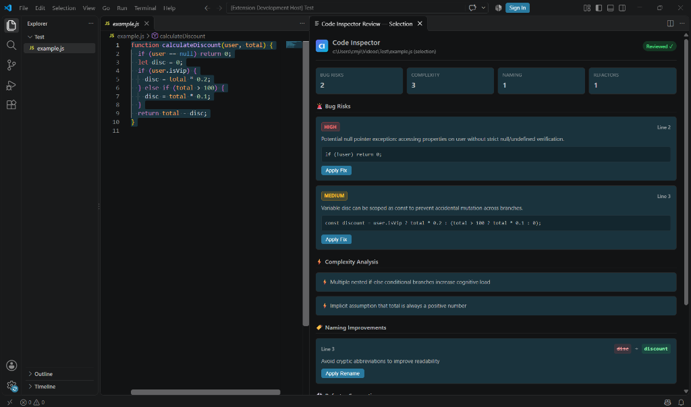

# Code Inspector 🔍⚡

**Code Inspector** brings intelligent, streamed inline code review and one-click refactoring directly into Visual Studio Code. Powered by Claude 3.5 Sonnet and backed by a low-latency Node.js caching tier with Redis, Code Inspector detects critical bug risks, pinpoints complexity hot spots, suggests clean naming improvements, and applies refactors with native `WorkspaceEdit` diffs.

---

## 📸 Overview & Live Preview

*Highlight any function or file block, press `Ctrl+Shift+K`, and review streamed suggestions with instantaneous one-click fixes.*

---

## 🚀 Key Features

- **⚡ Real-Time Streaming Review**: Suggestions stream directly into an integrated side panel (`ViewColumn.Beside`) as tokens arrive from Claude via Server-Sent Events (SSE).
- **🚨 Intelligent Bug Risk Detection**: Automatic categorization into `HIGH`, `MEDIUM`, and `LOW` severity with exact line references, clear descriptions, and instant **Apply Fix** actions.
- **⚡ Cognitive Complexity Scoring**: Quantitative complexity analysis highlighting deeply nested conditional branches and fragile edge cases.
- **🏷️ Idiomatic Naming Refinements**: Identifies cryptic abbreviations or non-standard identifiers (`disc` → `discount`) with side-by-side diff previews and one-click **Apply Rename**.
- **🛠️ One-Click Refactoring**: Transforms functions into clean, declarative implementations using native `vscode.WorkspaceEdit`, automatically presenting comparison diffs.
- **🗄️ SHA-256 Redis Caching Layer**: Hashes inputs (`sha256(code + language + mode)`) and caches results for 24 hours to prevent redundant API calls and deliver sub-50ms repeat reviews.
- **🛡️ Built-in Offline Dev Fallback**: Includes realistic development stream fallback when running offline or without an Anthropic API key.
- **🎨 Native VS Code Theme Integration**: Fluid UI inheriting your editor's CSS variables (`--vscode-editor-background`, `--vscode-button-background`, etc.) for zero visual dissonance.

---

## ⌨️ Command Reference

| Command | Command Identifier | Default Shortcut | Context / Availability | Description |
|---|---|---|---|---|
| **Code Inspector: Review Selection** | `codeInspector.reviewSelection` | `Ctrl+Shift+K` (Win/Linux) `Cmd+Shift+K` (macOS) | Active Editor Selection & Context Menu | Audits selected function or highlighted lines |
| **Code Inspector: Review File** | `codeInspector.reviewFile` | Command Palette | Active Editor | Performs full-file audit from top to bottom |
| **Code Inspector: Refactor** | `codeInspector.refactor` | Command Palette | Active Editor | Refactors highlighted function for readability |
| **Code Inspector: Clear Review Cache**| `codeInspector.clearCache` | Command Palette | Global | Clears both backend Redis and local caches |

---

## ⚙️ Configuration

Configure settings in **VS Code Settings** (`Ctrl+,` or `Cmd+,`) under **Extensions → Code Inspector Configuration**:

| Setting | Type | Default | Description |
|---|---|---|---|
| `code.apiUrl` | `string` | `http://localhost:3000` | Backend API endpoint for Code Inspector service |
| `code.apiKey` | `string` | `""` | Bearer token for authenticating extension requests |
| `codeInspector.apiUrl` | `string` | `http://localhost:3000` | Alias for backend API endpoint |
| `codeInspector.apiKey` | `string` | `""` | Alias for backend API key |

---

## 📄 License

Distributed under the [MIT License](LICENSE). Copyright © 2026 Christopher Njihia.
